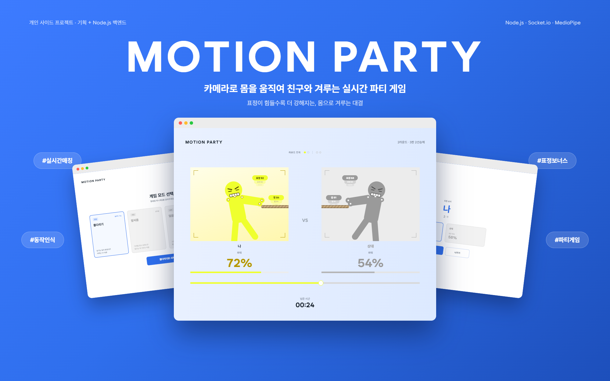
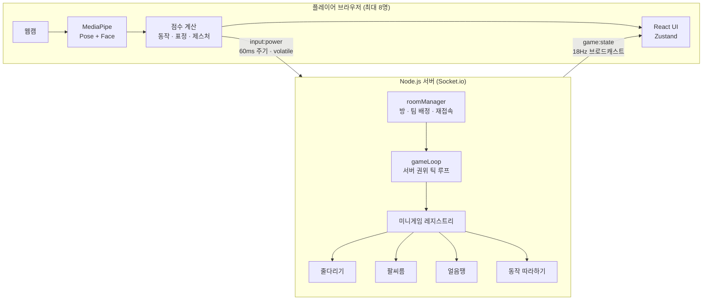
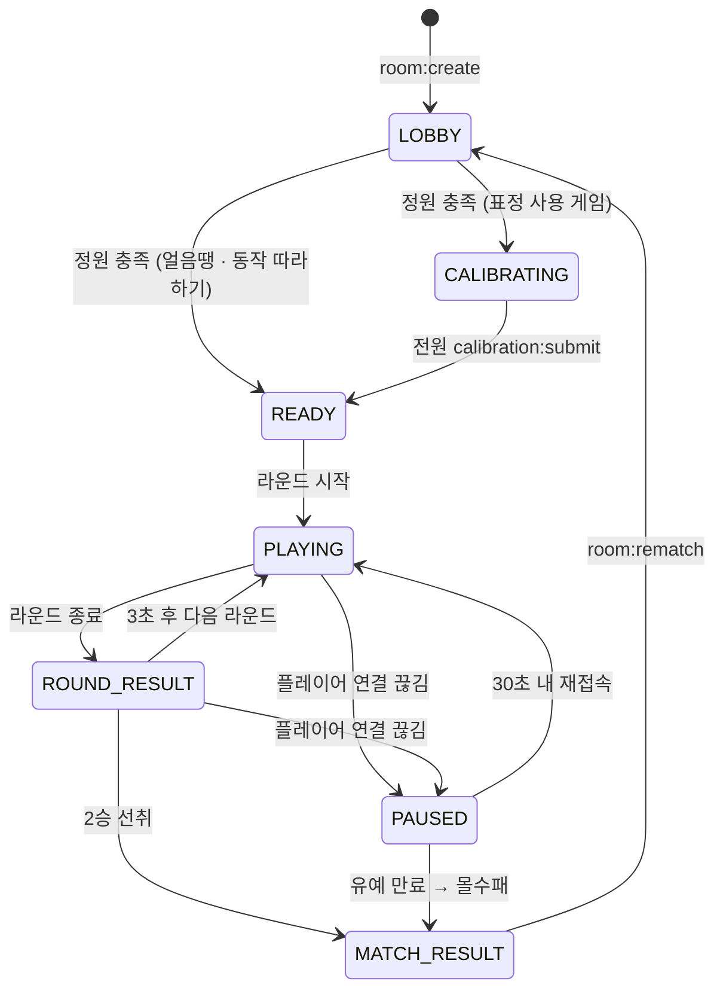

<div align="center">

# MotionParty

### 카메라로 몸을 움직여 친구와 겨루는 실시간 파티 게임



</div>

<br>

---

## 프로젝트 소개

컨트롤러 없이 **웹캠 하나로 동작과 표정을 인식**해, 여러 명이 실시간으로 겨루는 미니게임 파티 웹 서비스입니다.

브라우저에서 MediaPipe로 팔 동작과 표정을 추적해 "힘"으로 환산하고, Node.js + Socket.io 서버가 방 단위로 모든 플레이어의 입력을 모아 **서버 권위(authoritative) 틱 루프**로 승패를 판정합니다. 힘든 표정을 지을수록 힘에 보너스가 붙는 규칙 덕분에, 플레이하는 모습 자체가 웃긴 장면이 되는 파티 게임을 목표로 했습니다.

줄다리기 · 팔씨름 · 얼음땡 · 동작 따라하기 4종의 미니게임을 1:1 · 2:2 · 4:4로 즐길 수 있습니다.

> 🔒 동작·표정 인식은 모두 브라우저에서 처리하며, **영상은 서버로 전송되지 않습니다.** 서버로는 계산된 점수(0~1 숫자)만 전달됩니다.

<br>

---

## 개발 동기

카메라 기반 동작 인식 프로젝트를 기획하던 중, "여러 사용자가 동시에 하나의 대상을 조작하는 멀티플레이"가 미결정 과제로 남아 있었습니다. 이 아이디어를 별도 서비스로 확장한 것이 MotionParty입니다.

동작 인식은 이미 검증된 방향이었기 때문에, 여기에 **실시간 다중 사용자 동기화**라는 축을 더해 몸으로 직접 겨루거나 협력하는 파티 게임을 만들고자 했습니다. 방 단위로 여러 플레이어의 입력을 계속 받아 처리하고 브로드캐스트해야 하는 구조라, 다수의 동시 커넥션을 이벤트 기반으로 가볍게 다루는 Node.js를 백엔드로 선택했습니다.

목표는 세 가지였습니다.

- 별도 컨트롤러 없이 **몸과 표정만으로** 조작 가능한 게임 경험
- 미니게임을 낮은 비용으로 계속 추가할 수 있는 **확장 가능한 플랫폼 구조**
- 여러 명이 동시에 플레이해도 **공정하게 판정되는 실시간 동기화**

<br>

---

## 1. 개발 기간 및 작업 관리

### 개발 기간

- 전체 개발 기간 : 2026.09.11 ~ 진행 중

<br>

### 작업 관리

- GitHub로 버전을 관리하고, Conventional Commits 형식으로 커밋 단위를 기능별로 나눴습니다.
- Notion에 서비스 기획서 · 기능 명세서(FN-01 ~ FN-12) · 게임 내 튜토리얼 명세서를 정리하고, 결정 사항과 구현 이력을 함께 기록했습니다.

<br>

---

## 2. 개발 환경

- **Backend** : Node.js, TypeScript, Express 5, Socket.io 4, pino
- **Frontend** : TypeScript, React 19, Vite, Zustand
- **Vision** : MediaPipe Tasks Vision (PoseLandmarker + FaceLandmarker)
- **Test** : node:test (서버), Vitest + Testing Library + jsdom (클라이언트), oxlint
- **버전 관리** : Github
- **협업 툴** : Notion, Github

<br>

---

## 3. 기술 스택

### 기술 선정 이유

#### Node.js · Socket.io
- 방마다 최대 8명의 입력을 초당 십여 회씩 받아 취합하고, 같은 주기로 방 전체에 상태를 브로드캐스트해야 하는 구조라 이벤트 기반 비동기 I/O가 잘 맞았습니다.
- Socket.io의 room 기능으로 방 단위 브로드캐스트를, `volatile` 전송으로 "최신 값만 의미 있는" 실시간 상태 전송을 간단하게 구현할 수 있었습니다.
- 자동 재연결을 기본 제공해, 네트워크가 잠깐 끊겼다 돌아온 플레이어를 경기에 복귀시키는 흐름을 만들기 수월했습니다.

#### MediaPipe Tasks Vision
- 포즈(33개 관절)와 표정(52개 블렌드셰이프)을 하나의 라이브러리로 브라우저에서 동시에 추론할 수 있습니다.
- 모든 인식을 클라이언트에서 처리해 영상이 서버로 나가지 않으므로, 표정이 찍히는 게임에서도 프라이버시 부담을 줄일 수 있었습니다.
- GPU(WebGL) 델리게이트를 쓰다가 실패하면 CPU 델리게이트로 바꿔 재시도할 수 있어 기기 호환성을 확보하기 좋았습니다.

#### React · Zustand
- 시작 → 온보딩 → 대기실 → 캘리브레이션 → 튜토리얼 → 플레이 → 결과로 이어지는 화면을 컴포넌트 단위로 나누고, 화면 전환을 전역 상태 하나로 관리했습니다.
- 소켓 이벤트 핸들러(React 바깥)에서도 바로 상태를 바꿀 수 있는 Zustand가 실시간 게임 상태 관리에 적합했습니다.

#### TypeScript (서버 · 클라이언트 공통)
- `RoomStatus`, `RoomMode`, 소켓 페이로드 같은 게임 규칙의 핵심 타입을 명시해, 미니게임을 추가할 때 빠뜨린 처리를 컴파일 단계에서 잡을 수 있었습니다.

<br>

### 기술 스택 상세

| 구분 | 기술 |
|------|------|
| Language | TypeScript |
| Backend | Node.js, Express 5,  Socket.io 4 |
| Logging | pino (구조화 로깅), pino-pretty |
| Frontend |  React 19, Vite, Zustand, socket.io-client |
| Vision | MediaPipe Tasks Vision (PoseLandmarker, FaceLandmarker) |
| Test | node:test + tsx, Vitest, Testing Library, jsdom, oxlint |
| Collaboration |  Github, Notion |

<br>

---

## 4. ☁️ 서비스 아키텍처



영상은 브라우저 밖으로 나가지 않고, 서버는 플레이어별 `motionScore` · `expressionScore`(0~1)만 받아 게임 상태를 계산합니다.

<br>

---

## 5. 🔄 방 상태 흐름

별도 DB 없이 방·세션 상태를 서버 메모리에서 관리하며, 방 하나는 아래 상태를 오갑니다.



<br>

---

## 6. 📁 프로젝트 구조

```
motion-party/
├── server/
│   ├── src/
│   │   ├── index.ts            # Express + Socket.io 서버, /health
│   │   ├── socketHandlers.ts   # 소켓 이벤트 처리, 페이로드 검증, 재접속
│   │   ├── roomManager.ts      # 방 생성/참가, 팀 배정, 정원, 입력 만료 처리
│   │   ├── gameLoop.ts         # 서버 권위 틱 루프, 라운드/매치, 일시정지·재개
│   │   ├── types.ts            # 방·플레이어 타입, 게임 공통 상수
│   │   └── games/              # 미니게임 모듈 (registry, tugStyle, freezeTag, simonSays …)
│   └── test/                   # node:test 테스트 114개
└── client/
    └── src/
        ├── components/         # 화면 컴포넌트 (Lobby, WaitingRoom, Calibration, 플레이 화면 3종, 결과)
        │   └── ui/             # Gauge, RopeTrack, ScoreLine, TeamScore
        ├── hooks/              # useMotionCapture, useGameSocket, useInputSender, useCameraPreview
        ├── lib/                # 동작·표정·제스처 점수 계산, 스무딩, 공유 카메라, 설정 저장
        ├── store/              # Zustand 게임 스토어
        └── test/               # 가짜 소켓, 랜드마크 픽스처, rAF 큐 등 테스트 도구
```

<br>

---

## 7. 구현 내용

**서버 권위 실시간 게임 루프** `Socket.io` `Node.js`
- 클라이언트는 점수만 보내고, 위치·승패 판정은 모두 서버가 초당 18틱으로 계산해 방 전체에 브로드캐스트 (클라이언트 조작에 의한 치팅 여지 축소)
- 입력이 1초 이상 끊긴 플레이어(백그라운드 탭 등)는 점수를 0으로 처리해, 마지막 값이 계속 힘을 주는 문제 방지
- `game:state`를 `volatile`로 전송해 느린 클라이언트에 오래된 프레임이 쌓이지 않도록 처리
- 한 방의 틱·핸들러에서 예외가 나도 로깅 후 격리해, 다른 방의 경기가 함께 죽지 않도록 설계

**미니게임 확장 구조** `플러그인 모듈`
- 방·매칭·동기화 인프라와 게임 규칙을 분리하고, 각 게임은 `MiniGameModule`(`resetRound` · `tick` · `broadcastPayload`) 인터페이스만 구현
- 새 게임은 레지스트리에 모듈을 등록하는 것만으로 추가 (게임 루프 수정 없음)
- 줄다리기와 팔씨름은 "힘으로 위치를 밀어내는" 공통 메커니즘을 `createTugStyleModule`로 공유하고 속도·제한시간만 다르게 설정

**동작 · 표정 인식** `MediaPipe`
- 팔꿈치 각도의 프레임 간 변화량을 이동 평균해 "당기는 힘"으로 환산 (줄다리기 · 팔씨름)
- 어깨·손목 랜드마크로 상반신 전체 움직임량(얼음땡)과 4가지 제스처(동작 따라하기)를 판정
- 눈썹 찌푸림·눈 찡그림·입 앙다물기·코 찡그림 블렌드셰이프에 가중치를 둬 "힘든 표정 강도" 산출
- 최종 힘은 `동작 점수 × (1 + 표정 점수)`로 계산해, 표정은 동작을 대체하지 않고 곱연산 보너스로만 작용

**표정 캘리브레이션 · 표정 인식 끄기** `FN-08` `FN-09`
- 게임 시작 전 3초간 편안한 표정을 캡처해 개인별 베이스라인을 잡고, 플레이 중에는 베이스라인 대비 변화량으로 채점
- 얼굴이 감지되지 않으면 재시도를 안내하고, 표정이 부담스러운 사용자는 표정 인식을 끄고 동작만으로 플레이 가능

**팀전 · 싱크율 보너스** `FN-10`
- 1:1 · 2:2 · 4:4 모드 지원, 팀 배정과 정원 계산을 `perSideCapacity(mode)` 하나로 일반화
- 팀 내 가장 센 사람과 가장 약한 사람의 힘 차이가 작을수록 최대 +30% 보너스를 부여해, 박자를 맞추는 협동을 유도

**연결 끊김 대응** `재접속` `몰수`
- 경기 중 연결이 끊기면 방을 `PAUSED`로 전환하고 30초간 재접속 대기 (일시정지 시간은 라운드 시계에서 제외)
- socket.io 자동 재연결 시 `player:reconnect`를 자동 재전송하고, 새로고침해도 저장된 세션으로 경기에 복귀
- 유예가 만료되면 남은 팀의 몰수승으로 처리하고, 끊긴 플레이어를 방에서 정리해 유령 플레이어·빈 방 누수 방지

**입력 검증 · 보안** `Validation`
- 모든 소켓 페이로드를 검증: 누락·비정상 객체, `NaN`·문자열 점수, 잘못된 mode/gameType, 12자 초과 닉네임
- `input:power` · `calibration:submit`은 해당 플레이어의 현재 소켓에서 온 경우만 처리해 playerId 도용 차단
- `getMiniGame('__proto__')`처럼 상속 키로 프로토타입 객체가 조회되던 문제를 `Object.hasOwn`으로 차단

**테스트** `node:test` `Vitest` `Testing Library`
- 서버 114개: 소켓 이벤트, 방 관리, 게임 루프(mock timer로 라운드·매치·일시정지·tick 예외 복구), 미니게임별 규칙
- 클라이언트 229개: 점수 계산 로직, 공유 카메라 참조 카운트, 모든 화면 렌더링·상호작용, hook(소켓 이벤트·재접속·세션 복원, 전송 주기, GPU→CPU 폴백, 프레임 루프)
- 가짜 소켓, 조작 가능한 모션 캡처 mock, 수동 rAF 큐 등 테스트 도구를 직접 구성

<br>

---

## 8. ✨ 주요 기능

### 🎮 미니게임 4종

| 게임 | 조작 | 승리 조건 | 표정 보너스 |
|---|---|---|---|
| 🪢 **줄다리기** | 팔을 빠르게 당기기 | 로프를 끝까지 끌어오거나, 30초 후 누적 힘이 더 큰 팀 | ✅ |
| 💪 **팔씨름** | 팔을 빠르게 당기기 | 상대 팔을 끝까지 넘기거나, 20초 후 누적 힘이 더 큰 팀 | ✅ |
| 🧊 **얼음땡** | 4초간 크게 움직이고 2.5초간 멈추기 | 멈춰야 할 때 움직이면 즉시 패배, 30초 후 움직임 점수가 큰 팀 | ❌ |
| 🙆 **동작 따라하기** | 2.5초마다 바뀌는 제시 동작 따라하기 | 30초 동안 동작 일치도를 더 많이 쌓은 팀 | ❌ |

모든 게임은 **3판 2선승제**로 진행됩니다. 동작 따라하기 제시 동작은 왼팔 들기 · 오른팔 들기 · 양팔 들기 · 양팔 벌리기 4가지입니다.

### 🏠 방 만들기 · 참가
- 닉네임과 게임 · 모드(1:1 / 2:2 / 4:4)를 골라 방을 만들고, 6자리 방 코드로 친구 초대 (대소문자 · 공백 무관)
- 대기실에서 팀별 자리와 빈 자리, 내 카메라 미리보기 확인
- 정원이 차면 자동으로 경기 시작 (표정을 쓰는 게임은 캘리브레이션을 먼저 진행)

### 📖 온보딩 · 게임별 튜토리얼
- 최초 접속 시 카메라 권한 안내와 촬영 환경 가이드
- 게임별 첫 플레이 전에 관절형 SVG 캐릭터가 동작을 시연하는 튜토리얼과 연습 단계 제공
- 2:2 · 4:4에서는 싱크율(팀워크) 연습 단계 추가

### 📸 하이라이트 캡처
- 경기 중 표정 점수가 가장 높았던 순간을 자동으로 캡처해, 매치 결과 화면에서 확인 · 다운로드

### 📱 모바일 브라우저 대응 (1차)
- 카메라 해상도를 `ideal` 제약으로 완화하고 전면 카메라 우선 선택
- GPU 델리게이트 실패 시 CPU 델리게이트로 자동 재시도
- iOS Safari 자동재생(`muted playsInline`), 게임 중 핀치줌 방지

<br>

---

## 9. 🚀 기술적 성과

### 초기 번들 크기 축소
MediaPipe(~150KB)를 동적 import로 분리해 메인 번들 **458KB → 305KB** (gzip **139.5KB → 94.5KB**)

### 첫 플레이 대기 시간 단축
- 대기실에 있는 동안 해당 게임에 필요한 모델을 미리 다운로드
- 카메라 권한 요청과 모델 로드를 병렬화하고, 웹폰트 CSS를 비동기 로드해 첫 렌더링 차단 제거

### 프레임 루프 부하 감소
| 개선 | 방법 |
|---|---|
| 저사양 기기 발열 · 프레임 드랍 | 추론을 30fps로 제한하고, 표정 인식은 3프레임마다 1회만 실행 |
| 화면마다 쓰지 않는 점수까지 계산 | 화면별로 필요한 추적기(동작 · 움직임 · 제스처)만 켜도록 옵션 분리 |
| 매 프레임 React 리렌더 | 점수를 0.01 단위로 양자화해 값이 같으면 setState 생략 |
| 하이라이트 캡처 비용 | JPEG 캡처를 500ms 간격으로 제한하고 canvas 재사용 |
| 캘리브레이션 중 불필요한 추론 | 캘리브레이션 화면에서는 포즈 인식 비활성화 |

### 네트워크 전송량 감소
- 입력은 60ms 주기로 보내되, 값 변화가 0.01 미만이면 전송을 생략하고 400ms 하트비트만 유지
- 입력 · 상태를 `volatile`로 전송해 오프라인 동안 쌓인 입력이 재연결 후 한꺼번에 몰리지 않도록 처리

### 테스트 확장
- 서버 테스트 **23 → 114개**, 클라이언트 테스트 **0 → 229개**

<br>

---

## 10. 💥 트러블 슈팅

<details>
<summary><b>화면이 바뀔 때마다 카메라가 꺼졌다 켜지는 문제</b></summary>

<br>

**문제 상황**
- 튜토리얼 → 대기실 → 캘리브레이션 → 플레이로 넘어가거나, 라운드 사이 결과 화면(3초)을 지날 때마다 카메라가 다시 요청되며 검은 화면이 잠깐 보임

**문제 원인**
- 화면 컴포넌트마다 `getUserMedia`로 스트림을 따로 열고, 언마운트 시 트랙을 바로 종료하고 있었음

**해결 과정**
- 카메라 스트림을 앱 전역에서 하나만 두고 참조 카운트로 관리 (`lib/camera.ts`)
- 마지막 사용 화면이 사라져도 5초 유예 후에만 종료해, 화면 전환 사이에는 스트림을 그대로 재사용
- 권한 거부 · 실패한 요청은 캐시하지 않고, 트랙이 끊긴 스트림은 새로 요청하도록 처리
- 결과 : 전체 플로우에서 카메라 재요청 없이 스트림 유지, 대기실에서도 내 화면 미리보기 제공

**배운 점**
- 비싼 외부 자원(카메라, 모델)은 컴포넌트 생명주기가 아니라 앱 단위로 소유권을 관리해야 한다는 것을 체감

</details>

<details>
<summary><b>네트워크가 잠깐 끊겼을 뿐인데 30초 뒤 몰수패 처리되는 문제</b></summary>

<br>

**문제 상황**
- 와이파이가 잠깐 끊겼다 돌아와도 경기에 복귀하지 못하고, 30초 뒤 몰수패 처리됨
- 몰수 후 재경기를 하면 끊겼던 플레이어가 "유령"으로 남아 경기가 시작되거나, 빈 방이 메모리에 남음

**문제 원인**
- `player:reconnect`를 페이지 새로고침 시에만 보내고 있어, socket.io가 자동 재연결해도 서버는 새 소켓을 같은 플레이어로 인식하지 못함
- 유예 만료 후 몰수 처리만 하고, 끊긴 플레이어를 방에서 제거하지 않음

**해결 과정**
- 클라이언트에서 소켓 `connect` 이벤트마다 저장된 세션으로 `player:reconnect`를 재전송
- 끊김 직후 `PAUSED` 상태와 로스터를 즉시 브로드캐스트해 "재접속 대기" 배너 표시
- 유예 만료 시 끊긴 플레이어를 방에서 제거하고, 남은 인원이 없으면 방 삭제
- 재접속 · 몰수 · 재경기 예외 흐름을 mock timer 기반 테스트로 고정

**배운 점**
- 실시간 서비스에서는 "정상 흐름"보다 끊김 · 재연결 · 타임아웃 같은 경계 상황이 상태 꼬임의 대부분을 만든다는 것을 이해

</details>

<details>
<summary><b>얼굴이 보이는데도 캘리브레이션 재시도가 항상 실패하는 문제</b></summary>

<br>

**문제 상황**
- 얼굴이 안 잡혀 재시도 안내가 뜬 뒤, 카메라를 고쳐 얼굴이 보이는 상태에서 "다시 시도"를 눌러도 매번 실패

**문제 원인**
- 재시도마다 "얼굴 감지됨" 플래그를 `false`로 초기화했지만, 플래그는 `faceDetected` 값이 **바뀔 때만** 다시 켜지는 구조
- 이미 얼굴이 보이는 상태라 값이 바뀌지 않아, 플래그가 계속 `false`로 남음

**해결 과정**
- 시도를 시작할 때 플래그를 `false`가 아니라 **현재 감지 상태**로 초기화하도록 수정
- 재시도 시나리오를 컴포넌트 테스트로 추가해 회귀 방지

**배운 점**
- "변화"에 반응하는 effect로 상태를 관리할 때는, 초기값이 이미 목표 상태인 경우를 따로 고려해야 한다는 것을 체감

</details>

<br>

---

## 11. 소켓 이벤트

서버 기본 주소는 `http://localhost:3001`이며, 상태 확인은 `GET /health`를 사용합니다.

| 방향 | 이벤트 | 설명 |
|------|--------|------|
| C → S | `room:create` | 방 만들기 (닉네임, mode, gameType) |
| C → S | `room:join` | 방 코드로 참가 |
| C → S | `calibration:submit` | 캘리브레이션 완료 알림 |
| C → S | `input:power` | 동작 · 표정 점수 전송 (0~1) |
| C → S | `player:reconnect` | 저장된 세션으로 재접속 |
| C → S | `room:rematch` | 매치 종료 후 재경기 |
| S → C | `room:created` · `room:joined` | 방 · 플레이어 정보 (roomId, code, playerId, side) |
| S → C | `room:join_error` | 참가 실패 사유 (`NOT_FOUND` · `FULL` · `ALREADY_STARTED`) |
| S → C | `room:player_joined` | 로스터 · 방 상태 갱신 |
| S → C | `game:start` | 라운드 시작 |
| S → C | `game:state` | 틱마다 게임 상태 (위치, 팀 파워, 단계 등) |
| S → C | `game:round_end` · `game:match_end` | 라운드 · 매치 결과 |
| S → C | `player:disconnect` · `player:reconnect` | 플레이어 끊김 · 재접속 결과 |

<br>

---

## 12. 🚀 Getting Started

Node.js 22 이상과 웹캠이 필요합니다. (데스크톱 Chrome / Edge 권장)

### Server

```bash
cd server
npm install
npm run dev          # http://localhost:3001
```

| 환경 변수 | 기본값 | 설명 |
|---|---|---|
| `PORT` | `3001` | 서버 포트 |
| `CLIENT_ORIGIN` | `http://localhost:5173` | CORS 허용 클라이언트 주소 |

### Client

```bash
cd client
npm install
npm run dev          # http://localhost:5173
```

| 환경 변수 | 기본값 | 설명 |
|---|---|---|
| `VITE_SERVER_URL` | `http://localhost:3001` | 소켓 서버 주소 |

> 혼자 테스트할 때는 브라우저 창 두 개로 같은 방에 참가하면 1:1 경기를 확인할 수 있습니다.

### Test

```bash
cd server
npm test

cd ../client
npm run lint
npm test
```

<br>

---

## 13. 향후 계획

- 빠른 매칭 · 참가 가능한 방 목록
- 실기기(iOS Safari, 중저가 Android)에서 Pose + Face 동시 구동 성능 실측 및 추가 최적화
- 네트워크 지연을 고려한 타임스탬프 기반 입력 보정
- 계정 · 랭킹 · 전적 시스템
- 프론트엔드 · 실시간 서버 배포

<br>

---

<div align="center">
  <sub>개인 사이드 프로젝트 · 기획 + Node.js 백엔드</sub>
</div>
